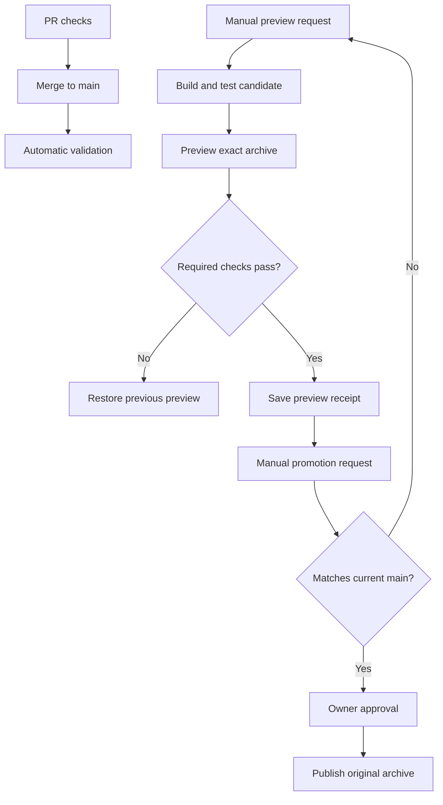

# Controlled preview and production releases

`main` is the source of approved code. Merging runs validation; it does not publish
the website. Hosting operations are dispatched from workflows on `main`, while an
exact source commit can be selected for preview.

## Normal release

1. Open a PR and pass **Frontend production build**, **PHP quality and tests**,
   and **Cross-browser responsive tests**. `main` requires a current branch,
   passing GitHub Actions checks and resolved conversations. Administrators cannot
   bypass these requirements. A second reviewer is not mandatory for the sole
   maintainer.
2. Run **Prepare verified preview release** from `main`. Leave `source_sha` empty
   for the selected main revision, or provide an exact 40-character candidate SHA.
   A source with outdated staging configuration/capacity helpers is refused; bring
   the branch up to date with main first. No UI work should start from an old
   infrastructure branch.
3. The main controller restores any pending preview DB/media backup with the existing refresh recovery helper, then recovers a journal-owned interrupted preview code publication,
   then invokes the shared CI workflow without hosting secrets. It builds frontend
   assets once, runs PHP and all browser projects, and packages production
   dependencies with those exact assets. Packaging only runs for this explicit
   candidate request. The archive revision must equal the checked-out Git revision.
4. The protected preview job downloads that archive, checks its digest and revision,
   checks account capacity, records rollback state, and deploys it with the existing
   isolated preview configuration. Public content, logo and uploads remain shared;
   the existing missing-seed-marker guard refuses reseeding existing content.
5. Desktop/mobile rendering, current sitemap-selected public pages, no-JavaScript
   content, crawler/visitor parity, local media, inert contacts, disabled payment
   providers, synthetic booking submission and dedicated preview admin login are
   mandatory. There is no functional-check opt-out. Production smoke tests must pass
   before and afterward at the same production revision.
   The browser checks run from GitHub. Preview crawler parity runs as real
   authenticated HTTP requests from the hosting account through pinned SSH; it
   requires status 200, matching public fallback HTML and canonical/robots tags,
   noindex protection, and the exact preview runtime revision. It uses the same
   public routes discovered by the browser, including real package/article pages.
   The review password is sent in SSH stdin and stays in memory. No hosting files,
   raw bodies, cookies, or credentials are saved by this check. Failure blocks
   finalize and triggers the existing rollback in both code publication and data
   refresh. Promotion receipts explicitly require `crawler_parity`.
   Detail pages are checked against their exact self-canonical route, the reviewed
   language robots policy, server page props and rendered head. Preview-only CMS
   articles/packages need not exist in production. Shared public hub metadata
   still compares with production. In run `43352458871`, an old preview-only inline
   photo fixture redirected to `/news` on production, exposing the previous
   incorrect cross-database baseline assumption; the existing code rollback passed.
   Article fragment checks use the application's stable English-heading IDs even
   when visible headings are translated; both the initial and hydrated heads must
   retain identical canonical/robots declarations. These checks change no content
   and do not relax preview authentication or noindex protection.
6. Browser failure restores the previous preview code and access protection. Database
   migrations are not reversed. A successful result commits the preview publication,
   retains rollback code and saves a small `preview-receipt-<run-id>` artifact. It
   contains code revisions, the archive digest and check results; no DB rows or
   credentials. Review the preview and its public screenshots.
7. After the candidate is merged, run **Promote verified preview release** from
   `main`, providing the successful preview run ID. Production eligibility requires
   its source commit to be preserved in main and its complete Git tree to equal
   current main. If main changes, prepare fresh preview evidence. The verification
   policy files must also match the versions that performed the preview checks.
8. The workflow checks that preview still serves that candidate, then waits for the
   repository owner's protected `production` approval. Administrator bypass is
   disabled. The sole maintainer can approve a release they initiated. Do not approve
   a release merely to test the gate; use **Check production approval gate**, which
   has no hosting operations, and cancel it after confirming it waits for review.
9. After approval, revalidate current main, original artifact and hosted preview
   identity. Download the original candidate archive from that preview run; do not
   run npm, Composer installation or another build during promotion. The existing
   `PRODUCTION_DEPLOY_ENABLED` switch is an additional stop switch, not permission
   to deploy automatically. Atomic deployment, backup, host health gates and the
   independent runner smoke test then run as documented in `atomic-deployment.md`.

`Protected staging deployment` remains a compatibility entry point delegating to
the same current controller. The old independent build/deploy rules were removed.
Production credentials are never referenced by validation or preview build jobs.
The `staging` environment must be restricted to the `main` branch so an old feature
branch's workflow cannot access hosting credentials; selecting an application SHA
as input does not change the trusted controller ref.

### Preview crawler verification transport

Read-only readiness run `43347470117` compared ordinary and Googlebot-style HTTP
requests with preemptive Basic authentication and the normal 401 challenge flow:

| Request origin | Ordinary | Googlebot-style |
|---|---|---|
| GitHub runner, either authentication mode | 200 | 403 |
| Hosting account, either authentication mode | 200 | 200 |

This establishes a request-path-dependent block, rather than a failure of the
application to render its public homepage or a missing-password retry alone.
The exact hosting/network rule was not identified through dashboard access.
Hostinger documents that [crawler identity is verified beyond the user-agent](https://www.hostinger.com/support/hostinger-cdn-search-engine-crawlers-and-seo/).
Changing a user-agent on a GitHub IP is not proof of verified Googlebot access.
The required origin-side parity check tests application behavior without
disabling firewall rules, exposing preview, spoofing an IP, accepting a 403, or
using a skip/fallback path. It does not certify real search-engine access through
the public edge; preview intentionally requires a password and is not indexable.
Production browser reviews retain their direct crawler check.

## Database and media refresh

Run **Refresh Preview Data** from `main` only when an explicit production-shaped
snapshot is wanted. It is a separate manual operation, never a deployment side
effect or scheduled synchronization. It retains the reviewed Hostinger-only backup,
read-only production snapshot, distinct preview DB, offline gate, actual-schema
sanitization, referenced public-media copy and coordinated DB/media rollback from
the original refresh implementation. See `preview-database-refresh.md` for exact
public/private field policy and failure recovery.

Do not refresh data just to publish CSS or another UI feature. Public business
content remains realistic; private customers, production authentication, payment
records, secrets and internal notes remain synthetic or removed. Integration and
contact behavior remains disabled even when public contact display is preserved.

## Hosting capacity and interruption handling

Production/preview deployment, refresh, rollback and retention share the host's
account-wide lock, then the site lock where applicable. GitHub mutation jobs share
`hosting-account` with cancellation disabled. A pending job is not a durable queue
of every release request: newer pending jobs can replace older pending jobs.

The monitor uses its own GitHub job group so a release waiting for human approval
does not block capacity monitoring. It still takes the same host account lock and
waits at most 120 seconds if an actual operation is running. No lock is stolen.
If hosting access, scans or budgets remain unsafe, it fails with an alert.

After a complete scan, known workflow transfer files older than 24 hours can be removed from the dedicated incoming directories. This includes interrupted code uploads and private preview configuration/helper transfers; recent files, unknown/private backups, symlinks, hardlinks, and pending-operation files are preserved. Production configuration JSON is never assumed to be a workflow transfer. No credential values are read or logged during this cleanup. At a warning or reservation failure, existing bounded release retention may also run, followed by remeasurement. Keep
active code and two rollback releases per site; never broaden cleanup to uploaded
media, customer data, backups, configuration or unknown directories. Pending code
or DB refresh journals prevent cleanup from removing recovery code.

Production deployment and manual code rollback share a private durable journal.
Catchable interruptions recover through the EXIT handler; SIGKILL is recovered on
the next invocation under the same locks. A rollback journal never authorizes
deleting an existing rollback target. `rollback-hostinger.sh <root> recover <url>`
recovers pending code state and verifies health without publishing another release.
No code recovery restores or reverses production database content.

Preview code has a separate private journal until hosted browser checks pass.
The next preview request recovers an interrupted journal before building. Public
entry protection and previous caches are restored; shared DB/media are preserved.
This is recovery on the next operation, not an always-running watchdog.

## Backup and monitoring limits

The **Deployment recovery safety** workflow performs an actual deployment-backup
command and restore into two new disposable MySQL databases. It verifies migrated
schema, fixture values, foreign keys, private permissions and failure cleanup.
This proves the mechanism; it does not prove an existing production backup has
been restored or that Hostinger provides an off-account backup. Never restore over
production as a test.

GitHub production monitoring is configured for every fifteen minutes, but observed
scheduled execution has had multi-hour gaps. Manual runs prove current health and
capacity, not future scheduling reliability. Independent uptime monitoring and
verified alert delivery require a separate monitoring account and alert destination.
Off-account backup coverage also remains to be established. Neither is silently
claimed enabled by these repository changes.

Source/runtime isolation remains separate databases on a shared Hostinger Unix
account. The deployment key is therefore not a strong account-level boundary
between production and preview. Separate hosting credentials/accounts would be
additional infrastructure work, not a property of this pipeline.
